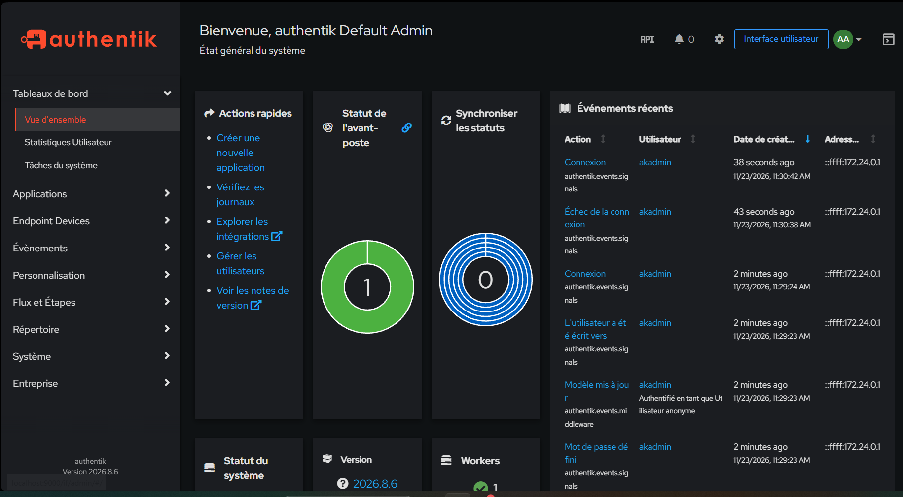
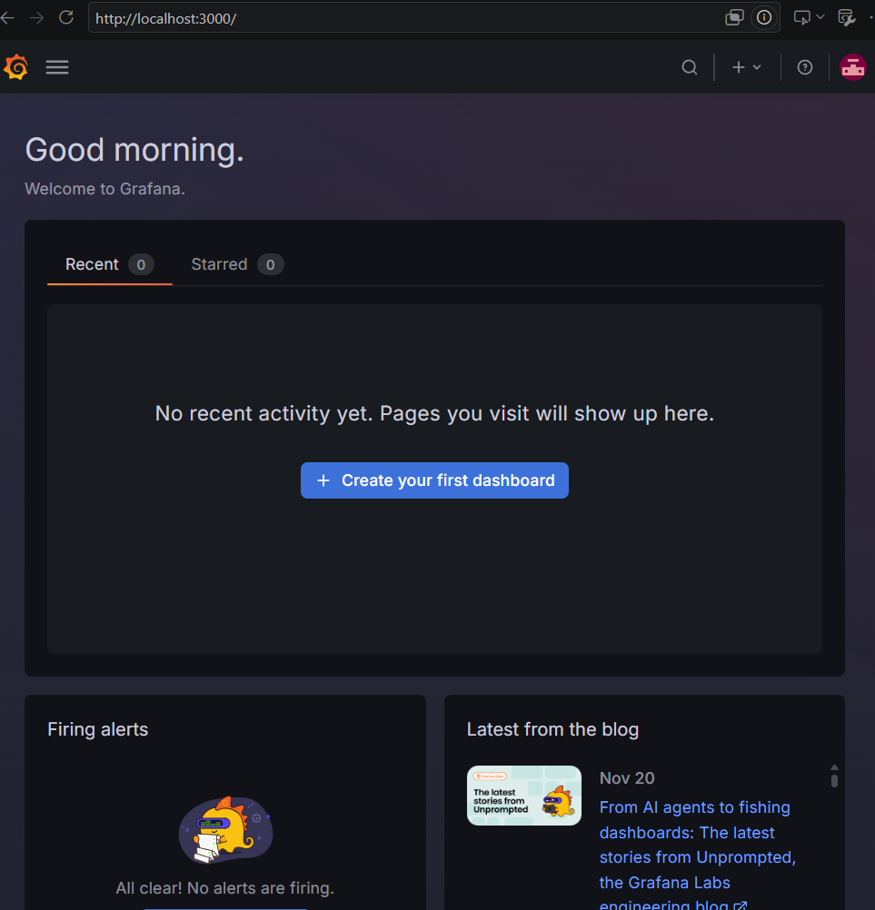
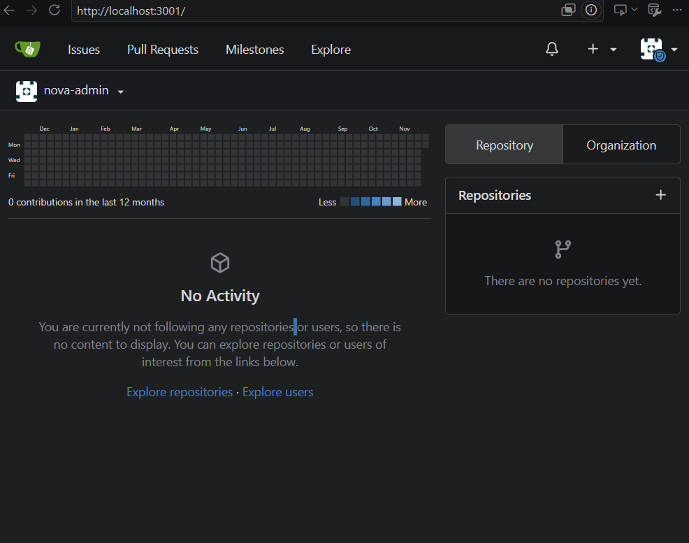
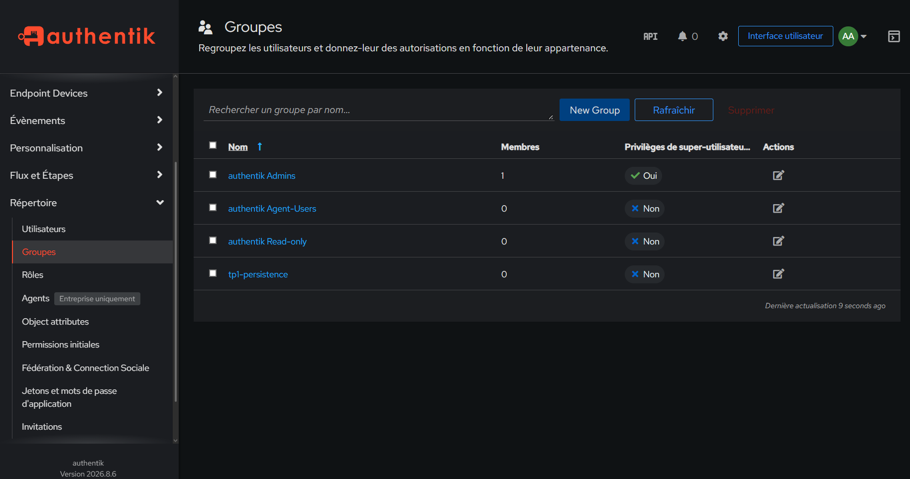
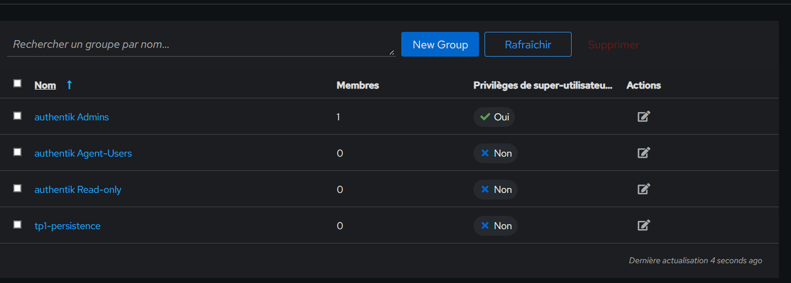
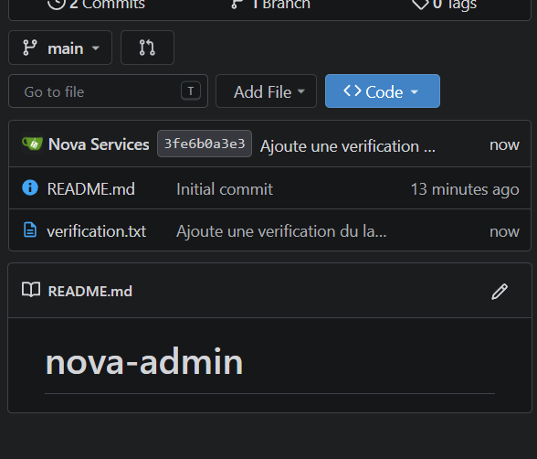

# TP1 — Installer Authentik, Grafana et Gitea avec Docker — Rendu

Projet Compose : `nova-iam` — réseau `iam-network`.

## 1. Fichiers livrés

| Fichier | Contenu |
|---|---|
| `docker-compose.yml` | 5 services, réseau, volumes, healthchecks |
| `.env.example` | Noms des variables, sans aucun secret |
| `scripts/init_env.py` | Génération unique des secrets dans `.env` (refuse d'écraser) |
| `.gitignore` | Exclut `.env`, `data/`, `certs/`, `backups/`, `captures/` |

`.env` n'est **pas** livré. Les fichiers sont à la racine du dépôt : [`docker-compose.yml`](../../docker-compose.yml), [`.env.example`](../../.env.example), [`scripts/init_env.py`](../../scripts/init_env.py).

## 2. Rôle de chaque service

| Service | Image | Rôle | Accès hôte |
|---|---|---|---|
| `postgres` | `postgres:16-alpine` | Base de données dédiée à Authentik (utilisateurs, groupes, flows, sessions…) | aucun port publié (`postgres:5432` en interne) |
| `authentik-server` | `ghcr.io/goauthentik/server:2026.8.6` (`command: server`) | Interface web, API, parcours d'authentification, endpoints OIDC/SAML | `http://localhost:9000` (9443 réservé HTTPS) |
| `authentik-worker` | même image (`command: worker`) | Tâches de fond : migrations, envoi d'e-mails, synchronisations, nettoyage, certificats, blueprints | aucun port publié |
| `grafana` | `grafana/grafana:13.3.1` | Tableaux de bord ; compte local `admin`, SSO et anonyme désactivés (OIDC au TP2) | `http://localhost:3000` |
| `gitea` | `gitea/gitea:28.4.0` | Forge Git (dépôts, utilisateurs) ; SQLite dans son volume, inscription libre désactivée, pas de SSH | `http://localhost:3001` (écoute 3000 dans le conteneur) |

Stockage : `postgres_data`, `grafana_data`, `gitea_data` (volumes nommés, préfixés `nova-iam_`) et `./data/authentik` (bind mount partagé server/worker, monté sur `/data`).

Choix de sécurité :
- ports publiés uniquement sur `127.0.0.1` ;
- chaque service ne reçoit que ses variables (pas de `env_file` global) ;
- worker en `root` comme le modèle officiel, mais **sans** `privileged` ni socket Docker ;
- variables obligatoires contrôlées par `${VAR:?...}` : Compose refuse de démarrer si `.env` manque.

## 3. Sortie de `docker compose ps`

Sortie vérifiée : elle ne contient aucun secret.

```
SERVICE            IMAGE                                 STATUS                   PORTS
authentik-server   ghcr.io/goauthentik/server:2026.8.6   Up 3 minutes (healthy)   127.0.0.1:9000->9000/tcp, 127.0.0.1:9443->9443/tcp
authentik-worker   ghcr.io/goauthentik/server:2026.8.6   Up 3 minutes (healthy)
gitea              gitea/gitea:28.4.0                    Up 3 minutes (healthy)   127.0.0.1:3001->3000/tcp
grafana            grafana/grafana:13.3.1                Up 3 minutes (healthy)   127.0.0.1:3000->3000/tcp
postgres           postgres:16-alpine                    Up 3 minutes (healthy)   5432/tcp
```

Contrôles de l'étape 8 :

| Contrôle | Résultat |
|---|---|
| PostgreSQL `SELECT 1` | `1` (1 row) |
| Authentik `/-/health/live/` | HTTP 200 |
| Authentik `/-/health/ready/` | HTTP 200 |
| Worker `ak healthcheck` | code de sortie 0 |
| Grafana `/api/health` | `"database": "ok"`, `"version": "13.3.1"` |
| Gitea `/` (assistant) | HTTP 200 |

Écart avec l'énoncé (Authentik 2026.8) : ouvrir directement `/if/flow/initial-setup/` renvoie « Request has been denied » (`FlowNonApplicableException`). Il faut passer par `http://localhost:9000/`, qui redirige vers `/setup`, puis lance le parcours d'initialisation.

Incident rencontré : un premier `docker compose pull` a produit des images corrompues (par exemple le binaire Grafana à 0 octet) parce que le disque hôte était presque plein. Les conteneurs redémarraient en boucle alors que `docker compose config` était valide. Correction : libérer de l'espace, supprimer les images, les retélécharger.

## 4–5. Captures

Les captures ne contiennent aucun secret.

**Administration Authentik** : compte `akadmin`, worker actif, version 2026.8.6.



**Grafana** : connexion avec le compte local `admin`.



**Gitea** : installation terminée, connexion avec `nova-admin`.



## 6. Test de persistance

Procédure : groupe témoin `tp1-persistence` créé dans Authentik (vide, sans superutilisateur), puis `docker compose down` **sans `-v`**, puis `docker compose up -d --wait --wait-timeout 600`.

| Vérification | Avant `down` | Après `up` |
|---|---|---|
| Groupe `tp1-persistence` (PostgreSQL) | présent (1) | présent (1) |
| Compte `akadmin` actif | présent (1) | présent (1) |
| Volumes `nova-iam_postgres_data`, `nova-iam_grafana_data`, `nova-iam_gitea_data` | — | conservés après `down` |
| Grafana : connexion `admin` (`/api/user`) | OK | HTTP 200 |
| Gitea : utilisateur `nova-admin` (`/api/v1/users/nova-admin`) | — | HTTP 200 |
| Gitea `/api/healthz` (installation conservée, pas de retour à l'assistant) | pass | pass |
| 5 services | healthy | healthy (`up` code 0) |

Conclusion : `down` supprime les conteneurs et le réseau, mais pas les volumes nommés ni `data/authentik`. Les comptes, le groupe témoin et l'installation Gitea survivent à la recréation des conteneurs. Le groupe témoin est supprimé ensuite pour garder un annuaire propre en vue du TP2.

| Avant `down` | Après `up` |
|---|---|
|  |  |

Rappel : cette persistance n'est pas une sauvegarde (voir question 9).

## Étape 12 — Dépôt Git privé (optionnel)

| Test | Résultat |
|---|---|
| Dépôt privé `nova-admin/iam-demo`, branche `main`, README initial | créé |
| `git clone` en HTTP avec authentification (mot de passe saisi dans l'invite, `credential.helper=` vide) | OK |
| Commit `3fe6b0a` « Ajoute une verification du laboratoire IAM » + `git push` | OK, `main` synchronisée avec `origin/main` |
| Page du dépôt sans connexion | HTTP 404 (dépôt invisible) |
| Clone anonyme (`info/refs?service=git-upload-pack`) | HTTP 401 (authentification exigée) |

Le dépôt accepte un commit authentifié et reste inaccessible aux personnes non connectées.



## Réponses aux questions intermédiaires

**Étape 1 — Client Docker installé vs moteur disponible ?**
Le client (`docker` CLI) n'est qu'un programme qui envoie des requêtes à l'API du démon. Le moteur (`dockerd` / Docker Desktop VM) est ce qui exécute réellement les conteneurs. `docker --version` ne prouve que la présence du client ; `docker info` échoue (« Cannot connect to the Docker daemon ») si le moteur n'est pas démarré ou si le contexte pointe ailleurs.

**Étape 3 — Pourquoi régénérer les secrets à chaque lancement casserait l'installation ?**
Les secrets sont « gravés » à la première initialisation : PostgreSQL enregistre le mot de passe de l'utilisateur à la création du volume, Authentik utilise `AUTHENTIK_SECRET_KEY` pour signer sessions/jetons et chiffrer des données, Grafana stocke le mot de passe admin dans sa base. Un nouveau `.env` produirait des valeurs différentes de celles déjà enregistrées : Authentik ne pourrait plus se connecter à PostgreSQL, les sessions et données chiffrées deviendraient invalides, et le mot de passe Grafana du `.env` ne correspondrait plus.

**Étape 14 — Pourquoi conserver le nom de projet `nova-iam` ?**
Compose préfixe les volumes nommés par le nom du projet (`nova-iam_postgres_data`…). Avec un autre nom (ou un autre dossier sans `name:`), Compose créerait de nouveaux volumes vides : les données sembleraient perdues alors qu'elles sont toujours dans les anciens volumes. Le `name: nova-iam` dans le Compose fixe ce nom quel que soit le dossier.

## 7. Questions de compréhension

1. **Problème résolu par un fournisseur d'identité** : centraliser les identités et l'authentification au lieu d'avoir un compte et un mot de passe par application. Un seul point pour créer, modifier, désactiver un compte (arrivées/départs), appliquer MFA et politiques, tracer les accès, et offrir le SSO.

2. **Authentification vs autorisation** : l'authentification prouve *qui* est l'utilisateur (mot de passe, MFA…) ; l'autorisation décide *ce qu'il a le droit de faire* (groupes, rôles, policies). On peut être authentifié et pourtant refusé.

3. **Serveur + worker** : le serveur doit répondre vite aux requêtes HTTP ; les tâches longues ou planifiées (migrations, synchronisations LDAP/SCIM, e-mails, nettoyage, génération de certificats, blueprints) sont déportées sur le worker. Cela sépare les charges et permet de les dimensionner indépendamment.

4. **Grafana et Gitea tous deux sur 3000** : chaque conteneur a sa propre pile réseau (namespace). Le port 3000 de Grafana et celui de Gitea sont sur des IP différentes du réseau Docker. Seule la publication sur l'hôte doit être unique : `3000→grafana:3000`, `3001→gitea:3000`.

5. **PostgreSQL non publié** : seuls Authentik server/worker ont besoin de la base et la joignent via `iam-network`. Publier le port augmenterait la surface d'attaque (brute force, exploitation) sans aucun besoin fonctionnel.

6. **`.env` / `.env.example` / gestionnaire de secrets** : `.env` contient les vraies valeurs, local, jamais versionné ; `.env.example` documente les noms des variables sans valeur, il est versionné ; un gestionnaire de secrets (Vault, coffre cloud, Docker/K8s secrets) stocke les secrets chiffrés avec contrôle d'accès, audit et rotation — ce que ne fait pas un simple fichier.

7. **Même clé Authentik entre redémarrages** : elle signe les sessions et jetons et sert au chiffrement de certaines données ; la changer invalide les sessions et rend illisibles les données chiffrées. Elle doit aussi être identique entre server et worker.

8. **Compose valide ≠ application fonctionnelle** : `docker compose config` ne vérifie que la syntaxe et l'interpolation. Il ne voit ni une image corrompue ou absente, ni un mauvais mot de passe, ni un port occupé, ni une migration qui échoue, ni un manque de mémoire/disque. Il faut des healthchecks et des tests réels (SQL, HTTP, connexion). *Vécu pendant ce TP : config valide, mais images corrompues par manque d'espace disque → conteneurs en boucle de redémarrage.*

9. **Persistance vs sauvegarde** : la persistance (volume) garde les données quand le conteneur est recréé ; elle est sur la même machine et subit les mêmes risques (`down -v`, corruption, panne disque, erreur humaine). Une sauvegarde est une copie indépendante, datée, stockée ailleurs et dont la restauration est testée.

10. **Tester la connexion Grafana locale avant le SSO** : c'est le compte de secours (*break-glass*). Si la configuration OIDC échoue ou si Authentik est indisponible, il faut pouvoir encore administrer Grafana. Le tester d'abord permet aussi de distinguer un problème Grafana d'un problème OIDC.

11. **Ne pas monter le socket Docker** : l'accès à `/var/run/docker.sock` équivaut à root sur l'hôte (lancer un conteneur privilégié montant `/`). Un outil IAM exposé sur le réseau compromis donnerait alors le contrôle complet de la machine. On ne le monte que si l'on a besoin du déploiement automatique d'outposts, idéalement via un proxy de socket restreint.

12. **À préserver pour une restauration complète** : `docker-compose.yml` et versions exactes des images ; `.env` (surtout `AUTHENTIK_SECRET_KEY` et `POSTGRES_PASSWORD`), stocké séparément et protégé ; dump PostgreSQL ; `data/authentik` (médias) ; `certs/` et `custom-templates/` ; volume Grafana (base SQLite copiée de façon cohérente, service arrêté ou via backup SQLite) ; volume Gitea (base, `app.ini`, dépôts).

13. **Tester push Git et confidentialité en plus du healthcheck** : un HTTP 200 prouve seulement que le serveur répond. Il ne prouve pas que l'authentification fonctionne, que l'écriture dans les dépôts est possible (droits du volume), ni qu'un dépôt privé est réellement inaccessible sans connexion. Ce sont des tests fonctionnels et de sécurité, pas de disponibilité.
