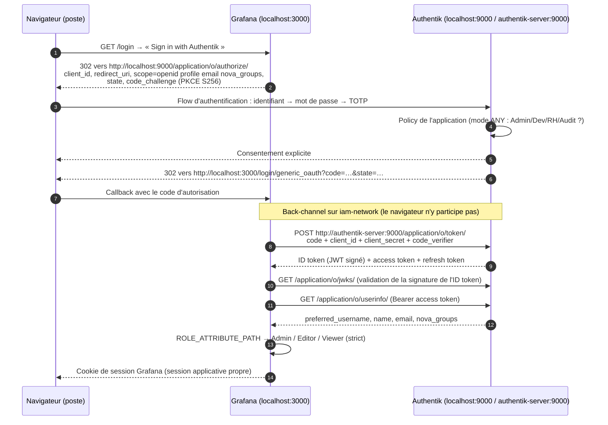

# TP2 — Gestion des identités, RBAC, MFA, SSO et OIDC avec Authentik — Rendu

Projet Compose `nova-iam` (suite du TP1). Authentik 2026.8.6, Grafana 13.3.1.

## Livrables

| # | Livrable | Fichier |
|---|---|---|
| 1 | Comptes, attributs, état initial et final | [comptes.md](comptes.md) |
| 2 | Groupes, rôles Grafana, permissions des dossiers | [rbac.md](rbac.md) |
| 3 | Scénarios, attendu, observé, preuves | [tests.md](tests.md) (+ [recette-auto.json](recette-auto.json)) |
| 4 | Perte du second facteur, secours Grafana | [recovery.md](recovery.md) |
| 5 | Configuration sans secret | [`docker-compose.yml`](../../docker-compose.yml), [`.env.example`](../../.env.example) |
| 6 | Captures expurgées | [captures/](captures/) |
| 7 | Schéma OIDC | section ci-dessous |
| 8 | Bonus CSV | [`users.csv`](../../users.csv), [`scripts/import_users.py`](../../scripts/import_users.py), preuve dans [comptes.md](comptes.md) |
| — | Outils de recette | [`scripts/sso_check.py`](../../scripts/sso_check.py), [`scripts/tp2_recette.py`](../../scripts/tp2_recette.py) |

Aucun mot de passe, Client Secret, jeton, QR code ni code de récupération n'est inclus.

## Configuration réalisée

| Objet Authentik | Valeur |
|---|---|
| Scope mapping | `nova-grafana-groups`, scope `nova_groups` (Admin, Dev, RH, Audit en appartenance directe) |
| Provider | `nova-grafana-oidc` : OAuth2/OpenID, client **Confidential**, grants `authorization_code` + `refresh_token`, Redirect URI **strict** `http://localhost:3000/login/generic_oauth` (type Authorization), signature `authentik Self-signed Certificate`, mappings openid / profile / email / nova-grafana-groups, claims dans l'ID token |
| Flows du provider | authentification : `default-authentication-flow` (avec MFA) ; autorisation : `default-provider-authorization-explicit-consent` |
| Application | `Grafana — Nova Services`, slug `grafana`, launch URL `http://localhost:3000`, mode **ANY**, bindings Admin, Dev, RH, Audit |
| MFA | stage `default-authentication-mfa-validation` : classes TOTP + Static, **Deny**, seuil `seconds=0` |

Côté Grafana, le service `grafana` du Compose a reçu le bloc Generic OAuth de l'énoncé, avec en plus la validation de signature de l'ID token (`VALIDATE_ID_TOKEN` + `JWK_SET_URL`). Le Client ID et le Client Secret viennent de `.env`. En fin de TP, le formulaire local et Basic Auth sont désactivés (étape 20).

Écarts constatés avec l'énoncé :
- Un provider créé hors assistant n'a aucun *grant type*. Sans `authorization_code`, Authentik répond `invalid_request`. Il a fallu l'ajouter.
- Grafana refuse « Disable user » pour un compte créé par OAuth. Bob a donc été retiré de l'organisation et ses sessions révoquées (voir [tests.md](tests.md), étape 19).
- Désactiver un compte dans Authentik 2026.8 supprime aussi ses sessions Authentik, mais pas celles de Grafana.

## Schéma OIDC (Authorization Code + PKCE)



Le **front-channel** (`localhost:9000`) passe par le navigateur. Le **back-channel** (`authentik-server:9000`) va directement du conteneur Grafana à Authentik : c'est là que le code est échangé contre les jetons, sans que les jetons ne passent par le navigateur.

**Question : pourquoi la Redirect URI doit-elle correspondre exactement ?** Le code d'autorisation est envoyé à cette adresse. Si Authentik acceptait une URI approximative (préfixe, autre port, autre chemin), un attaquant pourrait se faire renvoyer le code sur un point qu'il contrôle (*open redirect*, vol de code). En mode strict, l'URI doit correspondre exactement au schéma, à l'hôte, au port et au chemin, donc à `ROOT_URL` + `/login/generic_oauth`.

## Étape 18 : JWT (payload fictif uniquement)

```json
{
  "iss": "http://localhost:9000/application/o/grafana/",
  "sub": "identifiant-stable-opaque-de-charlie",
  "aud": "identifiant-du-client-grafana",
  "iat": 1800000000,
  "exp": 1800000300,
  "preferred_username": "charlie",
  "email": "charlie@nova-services.test",
  "nova_groups": ["Admin"]
}
```

| Claim | Signification |
|---|---|
| `iss` | Émetteur : l'issuer du provider, à comparer avec la découverte OIDC |
| `sub` | Identifiant stable et opaque du sujet, différent du username, qui peut changer |
| `aud` | Destinataire prévu : le Client ID de Grafana |
| `iat` / `exp` | Émission et expiration (ici 300 s, soit 5 minutes) |
| `preferred_username`, `email` | Identité affichée et login Grafana |
| `nova_groups` | Claim personnalisée qui alimente le mapping des rôles |

**Mini-exercice :**
1. **`nova_groups` modifié sans signature valide :** le validateur doit **rejeter** le jeton. La signature, calculée sur l'en-tête et le payload, ne correspond plus. Le jeton est considéré comme falsifié, et aucune claim ne doit être utilisée.
2. **Vérifier `aud` en plus de la signature :** un jeton correctement signé par Authentik pour une *autre* application reste valide cryptographiquement. Sans contrôle de `aud`, une application malveillante ou compromise pourrait rejouer chez Grafana un jeton qu'elle a reçu (*token substitution*).
3. **Expiration du jeton vs session Grafana :** `exp` limite la durée d'utilisation du jeton auprès d'Authentik ou d'une API. Une fois connecté, Grafana gère **sa propre session** par cookie, avec sa propre durée de vie et sa rotation. L'expiration du jeton ne déconnecte pas l'utilisateur de Grafana, et inversement. C'est pourquoi l'étape 19 a dû révoquer les sessions Grafana.

Décoder du Base64URL ne valide rien. Aucun vrai jeton n'a été copié dans un décodeur en ligne.

## Questions intermédiaires

**Étape 1 — Pourquoi ne pas publier le port PostgreSQL ?** Seuls les services Authentik en ont besoin, et ils le joignent via `iam-network` (`postgres:5432`). Le publier exposerait la base de l'IdP, qui contient comptes, sessions et configuration, à des attaques par force brute ou à l'exploitation de failles, sans aucun bénéfice fonctionnel.

**Étape 4 — Fermeture du compte vs fermeture des sessions :** voir [comptes.md](comptes.md). Le comportement a été démontré à l'étape 19 : Bob, désactivé dans l'IdP, a encore enregistré un tableau de bord avec sa session Grafana existante.

**Étape 11 — Pourquoi protéger un code de récupération comme un secret :** voir [recovery.md](recovery.md).

**Bonus — Pourquoi créer les comptes inactifs ?** Un compte inactif ne peut pas se connecter. L'import prépare donc les identités sans ouvrir d'accès. Avant l'activation, il faut faire approuver : la vérification de l'identité et du contrat (RH), les groupes ou droits demandés par le manager selon le moindre privilège, la remise contrôlée du mot de passe initial, l'enrôlement MFA, puis l'activation, tracée et justifiée.

## Questions de compréhension

1. **Identité / authentification / autorisation :** l'*identité* est la représentation d'une personne ou d'un service dans l'annuaire (alice et ses attributs). L'*authentification* prouve que celui qui se présente est bien cette identité (mot de passe + TOTP). L'*autorisation* décide de ce qu'elle a le droit de faire (groupe RH → Viewer, dossier RH en lecture).
2. **L'attribut `role` ne donne aucun droit automatiquement :** c'est une donnée descriptive. Seules une règle ou un mapping qui l'exploite *explicitement* (policy ABAC, expression) peuvent la transformer en droit. Ici, seuls les groupes sont transmis et traduits.
3. **Le groupe `Admin` ne doit pas être superutilisateur Authentik :** il sert à administrer *Grafana*, pas l'IdP. Le rendre superutilisateur donnerait à Charlie le contrôle de toutes les identités, de la MFA et des applications (escalade massive), contre le moindre privilège et la séparation des rôles.
4. **Admin d'organisation vs GrafanaAdmin :** Admin gère *une organisation* (utilisateurs, équipes, dossiers, sources de données). GrafanaAdmin administre *le serveur* : toutes les organisations, tous les utilisateurs, les paramètres globaux. Le mapping interdit GrafanaAdmin (`ALLOW_ASSIGN_GRAFANA_ADMIN=false`), et Charlie a bien `isGrafanaAdmin = False`.
5. **Editor ne limite pas au département Dev :** Editor est un rôle d'*organisation*. Il donne le droit d'édition partout où les permissions par défaut l'accordent (par exemple le tableau de démonstration à la racine). Le cloisonnement demande des permissions de dossier par équipe (étape 17).
6. **Retirer les anciens droits lors d'une mobilité :** les droits se cumulent. Sans retrait, l'utilisateur garde ceux de son ancien poste (*privilege creep*). Testé ici : avec Dev + Audit, Bob resterait Editor.
7. **Enrôler un TOTP vs imposer la MFA :** enrôler, c'est *posséder* un facteur. Imposer, c'est configurer le flow pour *exiger* un facteur à chaque connexion (`Deny` pour les non-équipés). Avec `Skip`, un compte sans appareil se connecte avec le seul mot de passe (vérifié avec `mfa-test` avant/après).
8. **TOTP et phishing :** le code n'est lié ni au site ni au canal. Un faux site peut demander mot de passe et code, puis les rejouer en temps réel sur le vrai (proxy de type *evilginx*) et voler la session. FIDO2/WebAuthn lie la réponse à l'origine du site et résiste à cette attaque.
9. **Client ID, Client Secret, PKCE :** le *Client ID* identifie Grafana auprès d'Authentik (public). Le *Client Secret* authentifie Grafana lors de l'échange du code au token endpoint (confidentiel, côté serveur). *PKCE* lie le code à la session qui l'a demandé (`code_verifier` secret, haché en `code_challenge`) : un code intercepté est inutilisable sans le verifier.
10. **Deux adresses Authentik :** le navigateur tourne sur le poste et joint Authentik par le port publié `localhost:9000`. Le conteneur Grafana, lui, ne peut pas utiliser `localhost`, qui le désigne lui-même : il joint Authentik par le DNS Docker `authentik-server:9000` sur `iam-network`. D'où le front-channel en `localhost` et le back-channel en `authentik-server`.
11. **Rôle du code d'autorisation :** c'est un intermédiaire court, à usage unique, qui transite par le navigateur. Les jetons, eux, sont obtenus par Grafana en back-channel, contre ce code, son secret et le PKCE. Les jetons ne sont jamais exposés dans l'URL ni dans l'historique du navigateur.
12. **Un JWT signé n'est pas confidentiel :** la signature garantit l'intégrité et l'émetteur, mais le payload n'est qu'encodé en Base64URL et lisible par quiconque obtient le jeton. La confidentialité demande du chiffrement (JWE) ou simplement de ne pas exposer le jeton (TLS, back-channel).
13. **Le SSO ne supprime pas les fiches applicatives :** chaque application garde sa propre fiche utilisateur (créée par `allow_sign_up` à la première connexion), avec ses rôles, équipes, préférences et sessions. Le SSO ne fait que déléguer l'authentification. Il ne propage ni suppression ni désactivation (il faudrait SCIM, une API ou une procédure). Bob existe toujours dans Grafana, hors organisation.
14. **La désactivation IdP ne prouve pas la fermeture des sessions :** elle n'agit qu'au prochain passage par Authentik. Les sessions applicatives déjà établies (cookie Grafana) et les jetons déjà émis restent valides jusqu'à leur expiration ou leur révocation. Démontré à l'étape 19 : sauvegarde réussie après la désactivation, refus seulement après révocation des sessions Grafana.
